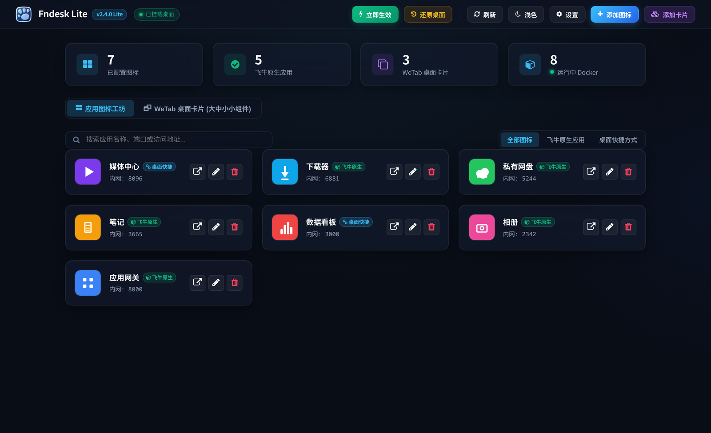
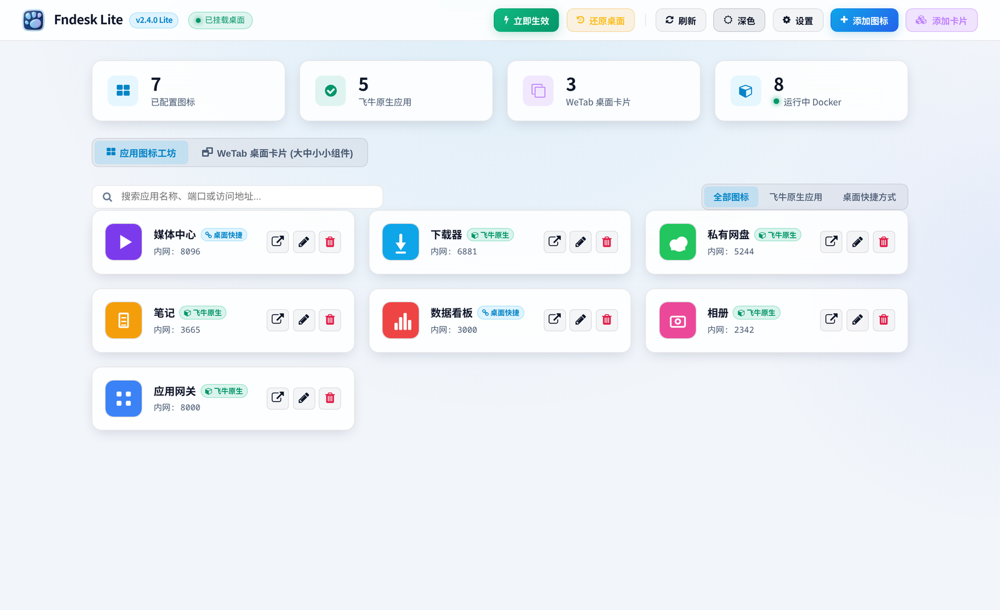
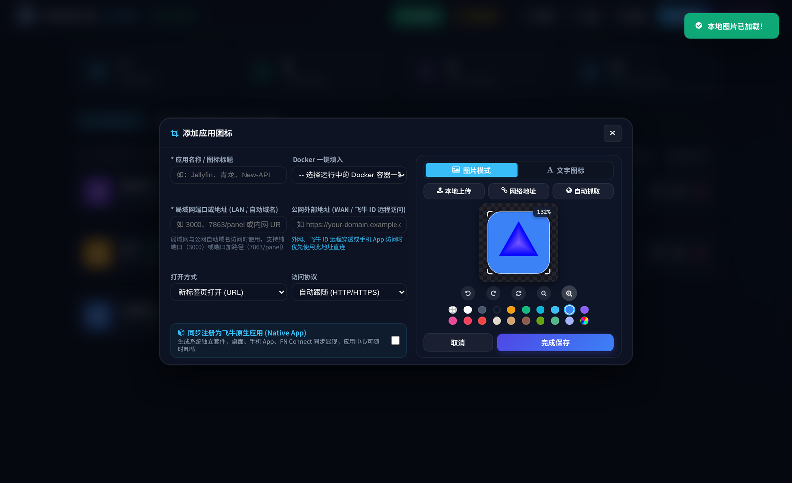
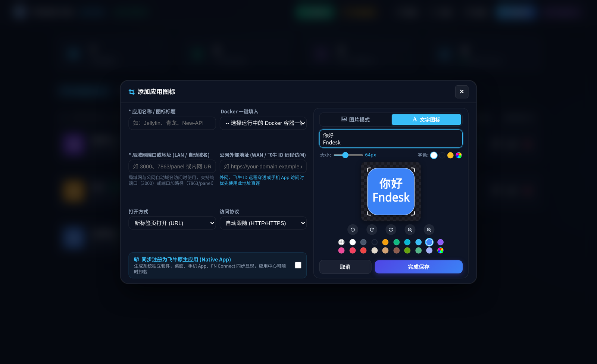
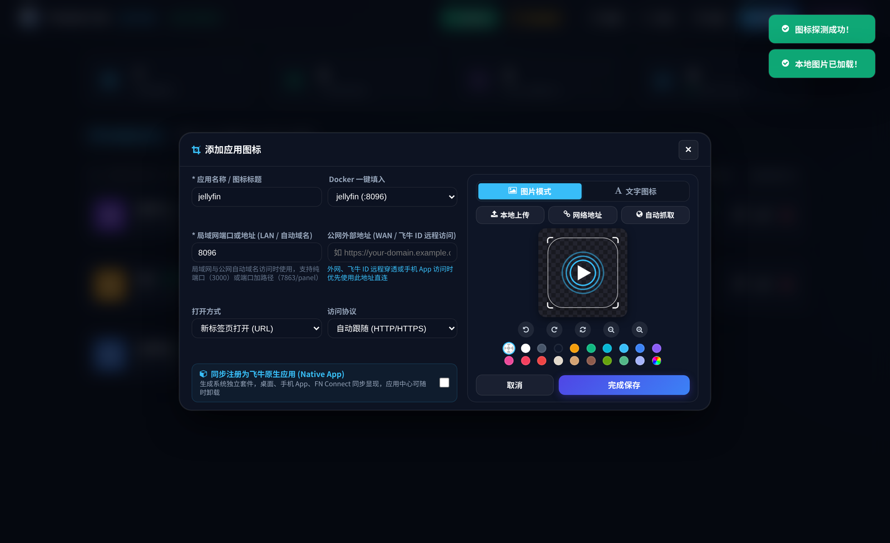

# Fndesk Lite · 飞牛桌面图标工坊

<div align="center">

**极简 · 纯净 · 完全开源 —— 专注飞牛桌面图标与应用快捷方式管理**

为 [飞牛 fnOS](https://www.fnnas.com/) 打造的轻量级套件：告别闭源臃肿与无关杂项，只做一件事 —— 把桌面入口与图标做到最好用。


</div>

---

## 📸 界面预览

### 管理面板（深色 / 浅色主题）





### 图标工坊 · 图片模式

拖拽 / 滚轮缩放、飞牛 Squircle 平滑圆角、内边距留白、底色与投影随心调节，所见即所得。



### 图标工坊 · 文字图标模式

直接输入文字即可生成图标，支持回车换行、18~140px 字号平滑微调与字色自定义。



### Docker 一键导入

自动嗅探本机运行中的容器，一键带入名称、镜像与映射端口。



### WeTab 桌面卡片小组件

实时天气、倒计时纪念日、数字时钟、便签备忘，支持大 / 中 / 小三种尺寸形态。


### 套件设置


> 以上截图均为演示数据，与任何真实环境无关。

---

## ✨ 核心亮点

- **⚡ 飞牛原生应用图标（Native App）**
  - 基于飞牛官方套件规范，一键生成独立的 APP 桌面图标与启动项。
  - 完全独立存在，可在飞牛应用中心随时**一键干净卸载**，不污染系统、不残留冗余文件。
  - 跨端体验一致：Web 桌面、飞牛手机 APP、FN Connect 远程访问均可原生显示。

- **🎨 专业级图标工坊（Icon Studio）**
  - **苹果级 Squircle 平滑圆角**：内置仿 iOS / macOS 连续曲率超椭圆算法，告别生硬机械圆角。
  - **尺寸与留白**：滚轮 / 按钮自由缩放（10% ~ 2000%），内边距留白让标志拥有呼吸感。
  - **多种取图方式**：本地上传、在线图片地址粘贴、Ctrl+V 剪贴板粘贴、网站 Favicon 自动嗅探。
  - **无损二次编辑**：原始素材（含 SVG 矢量图）会一并持久化保存，反复编辑不回放大、不丢边缘。
  - **文字图标**：直接输入文字生成图标，支持换行排版、字号与字色自定义。
  - **丰富底色**：透明 / 纯色（内置 16 款常用色板）/ 自定义取色。

- **🐳 Docker 容器一键导入**
  - 自动嗅探 NAS 上正在运行的 Docker 容器列表，一键带入容器名称与对外映射端口，免手动记忆。

- **🌐 高清 Favicon 自动嗅探**
  - 输入网址或端口，后端自动抓取目标站点的 Favicon / Apple Touch Icon，无需到处找图。

- **🖥️ 桌面小组件与智能路由**
  - WeTab 风格桌面卡片：天气、倒计时、时钟、便签，尺寸自由。
  - 自动识别访问方式（内网 IP / 公网域名 / 飞牛 ID 二级路径），图标点击直达应用，不再跳回登录页。

- **🚀 极简纯净的开源架构**
  - **零外部二进制黑盒**：不含任何闭源 `*-go` 可执行程序。
  - **原生 Node.js 服务**：全开源 JavaScript 实现，透明、安全、可控，常驻内存仅十余兆。
  - **一键还原防搞坏**：自动备份出厂 `index.html`，随时无损还原飞牛桌面。

---

## 🙏 致敬原项目

Fndesk Lite 的想法与起点，来自飞牛社区里那个令人惊艳的项目：

> **[IMGZCQ/Fndesk](https://github.com/IMGZCQ/Fndesk)** —— *飞牛桌面百宝箱 · 桌面图标管理工具 · 飞牛补全计划*

原作者以一己之力把「我的飞牛我做主」这件事做到了极致：主题复刻、动态壁纸、图标与文件夹管理、
桌面小组件、音乐播放器、右键菜单拓展…… 它证明了飞牛的桌面可以被玩到什么程度，
也给了无数人改造自家 NAS 的勇气与灵感。**Fndesk Lite 正是站在这个肩膀上出发的。** 💙

Fndesk Lite 与原项目的关系，是一次**聚焦式的重构**，而非替代：

| | [IMGZCQ/Fndesk](https://github.com/IMGZCQ/Fndesk) | Fndesk Lite（本项目） |
| --- | --- | --- |
| 定位 | 飞牛桌面**百宝箱**（全能） | 飞牛桌面**图标工坊**（聚焦） |
| 形态 | 含闭源 `fndesk-go` 二进制 | 纯开源 Node.js，零外部二进制 |
| 覆盖 | 主题 / 壁纸 / 图标 / 组件 / 音乐 / 右键菜单… | 图标 · 快捷方式 · 原生应用 · 桌面组件 |
| 资源占用 | 功能丰富，体积较大 | 十余兆内存，极简常驻 |

如果你想体验完整的「飞牛百宝箱」，请直接前往原项目；如果你只想要**干净、轻量、可控**的
图标与桌面入口管理，那么 Fndesk Lite 就是为你准备的。

再次感谢 **IMGZCQ** 与所有为飞牛生态付出心血的开发者 🙌

---

## 🛠️ 安装与使用

### 1. 打包安装包

```bash
./build-fpk.sh            # 生成 fndesk.fpk
```

### 2. 应用中心安装

在飞牛应用中心左下角选择 **手动安装**，选中生成的 `fndesk.fpk` 即可。

### 3. 本地开发安装

```bash
appcenter-cli install-local
```

### 4. 访问管理面板

```
http://<你的飞牛 NAS 内网 IP>:9990/
```

或在飞牛桌面直接点击 **Fndesk Lite** 快捷方式进入。

---

## 📁 项目结构

```
.
├── manifest                 # 飞牛套件元数据配置
├── cmd/
│   └── main                 # 套件启动、停止、守护与健康检查脚本
├── config/
│   ├── privilege            # 套件运行权限配置（root）
│   └── resource             # 依赖资源描述
├── docs/screenshots/        # README 展示截图
├── app/
│   ├── server/
│   │   ├── server.js        # 核心轻量 Node.js 后端服务（端口 9990）
│   │   ├── index.html       # 单页管理控制台
│   │   ├── app.js           # 前端交互与 Icon Studio Canvas 渲染引擎
│   │   ├── style.css        # 现代玻璃拟态 UI 样式
│   │   ├── fonts/           # 本地离线 FontAwesome 矢量图标
│   │   ├── static/          # 桌面注入脚本
│   │   └── fndesk_app/      # 原生应用生成模板骨架
│   └── ui/
│       ├── config           # 飞牛桌面应用入口声明
│       └── index.cgi        # 轻量 CGI 反向代理网关
└── wizard/                  # 安装与卸载向导
```

---

## 🔒 数据与安全

- **数据存储路径**：所有图标配置存储于 `@appshare/fndesk/deskdata/data.json`，升级或重装均可保留。
- **管理密码**：首次进入可设置管理密码（SHA-256 加盐保存于 `pw.json`）；忘记密码时删除 `deskdata/pw.json` 即可重新初始化。
- **一键还原**：自动备份出厂桌面 `index.html`，支持随时无痕还原，避免改坏系统。

---

## 📄 开源许可证

本项目基于 [MIT 许可证](LICENSE) 开源，欢迎 Fork、提交 PR 或 Issue。

原项目 [IMGZCQ/Fndesk](https://github.com/IMGZCQ/Fndesk) 版权归其原作者所有，本项目对其表示诚挚敬意与感谢。
